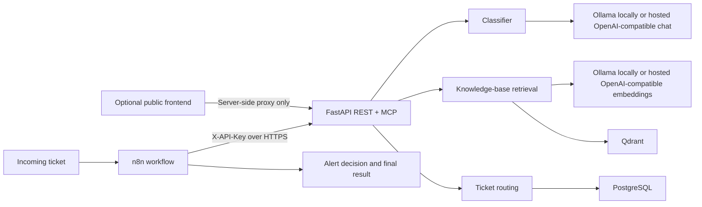

# AI Support Ticket Triage Agent

A Python service for classifying support tickets, retrieving relevant knowledge-base content, and routing tickets with an alert decision. One FastAPI process exposes the REST API used by n8n and the Streamable HTTP MCP server at `/mcp`; both call the same tool functions.

## Architecture



The repository does not contain frontend source, a Docker Compose file, or an exported n8n workflow. The existing n8n workflow is configured in the n8n instance; its HTTP Request nodes can use the configurable API base URL described below.

## Component and deployment audit

| Component | Current implementation and deployment requirement |
| --- | --- |
| FastAPI REST and MCP | `mcp-server/server.py` exposes `/health`, `/classify_ticket`, `/query_knowledge_base`, `/route_ticket`, and mounts MCP at `/mcp`. It is an ordinary long-running ASGI service; deploy it as a container or managed Python service. |
| Classification | `tools/classify.py` applies deterministic rules around the model result. Local default is Ollama `tinyllama` at `OLLAMA_HOST`; production can select an OpenAI-compatible chat endpoint via environment variables. |
| RAG embeddings | `tools/providers.py` uses local Ollama `nomic-embed-text` by default or a configured OpenAI-compatible embeddings endpoint. `rag-ingest/ingest.py` uses the same adapter as live queries. |
| Qdrant | The query and ingestion code use `QDRANT_HOST`, optional `QDRANT_API_KEY`, and `QDRANT_COLLECTION`. Production needs a reachable managed Qdrant or a separately operated Qdrant service. |
| PostgreSQL | `tools/ticket_router.py` persists routed tickets using required `POSTGRES_URL`. Production can use Supabase PostgreSQL or another PostgreSQL provider. The table definition is in `mcp-server/tickets.sql`. |
| Docker | Docker is not required by the Python code itself. The root Dockerfile packages the API. Local Qdrant, PostgreSQL, and n8n can continue running in Docker; there is no project Compose file to replace those currently running containers. |
| n8n | n8n calls the REST endpoints server-to-server with `X-API-Key`. Its API credential belongs in n8n's credential store, not in browser code or a workflow export. |
| Persistent process/local filesystem | The FastAPI/MCP server needs a running process. The knowledge base is read from `rag-ingest/knowledge_base` during ingestion; deployed query instances use vectors in Qdrant and do not need the source files at runtime. |

### Provider and hosting decisions

- The current combined FastAPI/MCP entry point can remain. A separate REST-only entry point is not required on a container host.
- Keep MCP on the same service for internal/authorized clients; use an ingress rule to restrict `/mcp` if public demo users should only access REST.
- Vercel is appropriate for an optional frontend. Do not run this current Python/MCP service, Ollama, Qdrant, or PostgreSQL as Vercel serverless functions. The local Ollama process is not reachable from Vercel.
- A public deployment needs hosted chat and embedding endpoints, unless the backend container can securely reach an independently hosted Ollama server. The service does not silently substitute a local model in production: select and configure a provider explicitly.
- Use hosted PostgreSQL and Qdrant for a multi-user demo. Qdrant and the embedding model used to ingest vectors must match the live embedding model's vector dimensions.
- Keep `LLM_API_KEY`, `EMBEDDING_API_KEY`, `POSTGRES_URL`, `QDRANT_API_KEY`, and `API_KEY` in deployment secrets or server-side n8n credentials. Never place them in frontend variables exposed to the browser.

## Local setup

Requirements: Python 3.10+, Ollama, and local PostgreSQL/Qdrant services. n8n is optional if only testing the REST API.

1. Create an environment file from the safe template and set a fresh `API_KEY` and your local PostgreSQL URL. The template uses the project-local PostgreSQL port `15432` as an example; adjust it to your actual local service.

   ```powershell
   if (-not (Test-Path mcp-server\.env)) { Copy-Item .env.example mcp-server\.env }
   ```

2. Install the API dependencies and run the service:

   ```powershell
   Set-Location mcp-server
   python -m venv .venv
   .\.venv\Scripts\Activate.ps1
   python -m pip install -r requirements.txt
   python server.py
   ```

   The server listens on `0.0.0.0:8000` by default. Ollama defaults to `http://localhost:11434`; pull `tinyllama` and `nomic-embed-text` before using local classification and RAG.

3. Ensure the `tickets` table exists. From `mcp-server`, apply the schema to the configured database:

   ```powershell
   psql "$env:POSTGRES_URL" -f tickets.sql
   ```

4. Ingest the knowledge base:

   ```powershell
   Set-Location ..\rag-ingest
   python -m pip install -r requirements.txt
   python ingest.py
   ```

The default local Qdrant URL is `http://localhost:6333`. Ingestion is safe to rerun: point IDs are deterministic and stale points are removed within the configured collection.

## Docker setup

Build the API image from the repository root:

```powershell
docker build -t support-triage-agent .
```

For a container connecting to services running on the Windows host, configure the copied `mcp-server\.env` with host-reachable addresses (for example `http://host.docker.internal:11434`, `http://host.docker.internal:6333`, and PostgreSQL at `host.docker.internal:15432`). Run it with:

```powershell
docker run --rm --name support-triage-api -p 8000:8000 --env-file mcp-server\.env support-triage-agent
```

The API image does not bundle Ollama, Qdrant, PostgreSQL, or n8n. Do not publish database, Qdrant, Ollama, or n8n administrative ports to the public internet. The health check is `GET /health`.

## Environment variables

Copy `.env.example` to `mcp-server/.env` for local API and ingestion runs. In production, configure these directly as deployment secrets/environment variables instead of copying a local `.env`.

| Variable | Default / required | Purpose |
| --- | --- | --- |
| `API_KEY` | Required | REST and MCP authentication using `X-API-Key`. Must be a unique high-entropy value. |
| `HOST`, `PORT` | `0.0.0.0`, `8000` | Bind address and port; cloud platforms commonly set `PORT`. |
| `LOG_LEVEL` | `INFO` | Application log level. |
| `RATE_LIMIT_PER_MIN` | `60` | Per-process request limit for protected REST endpoints. |
| `CORS_ORIGINS` | Empty | Comma-separated frontend origins. CORS is enabled only for explicitly listed origins. It is not a substitute for API authentication. |
| `POSTGRES_URL` | Required for routing | PostgreSQL connection string. Use the provider's TLS/SSL-enabled URL in production. |
| `LLM_PROVIDER` | `ollama` | Chat provider: `ollama` or `openai_compatible`. |
| `OLLAMA_HOST` | `http://localhost:11434` | Local Ollama host, used by local chat and embedding adapters. |
| `CLASSIFY_MODEL` | `tinyllama` | Ollama chat model used when `LLM_MODEL` is not set. |
| `LLM_BASE_URL`, `LLM_API_KEY`, `LLM_MODEL` | Required for `openai_compatible` | Chat endpoint base (usually ends with `/v1`), server-side bearer key, and provider model name. |
| `EMBEDDING_PROVIDER` | `ollama` | Embedding provider: `ollama` or `openai_compatible`. |
| `EMBED_MODEL` | `nomic-embed-text` | Model identifier sent to the configured embedding provider. |
| `EMBEDDING_BASE_URL`, `EMBEDDING_API_KEY` | Required for hosted embeddings | OpenAI-compatible embedding base (usually ends with `/v1`) and server-side bearer key. |
| `QDRANT_HOST` | `http://localhost:6333` | Qdrant URL; use the cloud cluster URL in production. |
| `QDRANT_API_KEY` | Optional locally | Qdrant Cloud API key. |
| `QDRANT_COLLECTION` | `knowledge_base` | Vector collection used by ingestion and queries. |
| `CHUNK_SIZE`, `CHUNK_OVERLAP` | `800`, `100` | Knowledge-base chunking settings for ingestion. |
| `TRIAGE_API_BASE_URL` | `http://host.docker.internal:8000` | Base URL for n8n HTTP Request nodes; set it to the deployed HTTPS API URL in production. Store the API key separately in n8n credentials. |

When changing the embedding model, re-ingest into a new collection or deliberately recreate the old collection after backing up any required vectors. The collection's vector dimension must match the selected model.

## API endpoints

Except for `GET /health`, REST endpoints require `X-API-Key`. All JSON requests use `Content-Type: application/json`.

| Method and path | Request JSON | Success response |
| --- | --- | --- |
| `GET /health` | None | `{"status":"ok"}` |
| `POST /classify_ticket` | `{"subject":"...","body":"..."}` | `{"category":"...","priority":"...","reasoning":"..."}` |
| `POST /query_knowledge_base` | `{"query":"...","top_k":3}` (`top_k` optional, 1–10) | `{"results":[{"text":"...","source":"...","score":0.0}]}` |
| `POST /route_ticket` | `{"subject":"...","body":"...","category":"...","priority":"..."}` | `{"ticket_id":1,"team":"...","priority":"...","should_alert":false}` |

`/mcp` serves the same three tool functions over Streamable HTTP and also requires `X-API-Key`. Never treat routing as successful if PostgreSQL is unavailable: it now returns a service error rather than a synthetic, non-persistent ticket ID.

Example PowerShell request (run from any directory after setting `$apiKey` securely in the current session):

```powershell
$headers = @{ 'X-API-Key' = $apiKey; 'Content-Type' = 'application/json' }
Invoke-RestMethod -Uri 'http://localhost:8000/classify_ticket' -Method Post -Headers $headers -Body '{"subject":"Password reset issue","body":"I cannot reset my password"}'
```

## n8n workflow

The existing workflow pattern remains:

```text
Incoming ticket
  -> Classify Ticket
  -> Knowledge Base
  -> Route Ticket
  -> Alert required?
       -> alert payload
       -> no alert
  -> final result
```

For each HTTP Request node, use `{{$env.TRIAGE_API_BASE_URL}}` as the base and append the appropriate path. Configure the n8n process with:

- Local API running on the host: `TRIAGE_API_BASE_URL=http://host.docker.internal:8000`
- Deployed API: `TRIAGE_API_BASE_URL=https://<your-api-domain>`

Configure one reusable n8n **Header Auth** credential with header name `X-API-Key` and the API key value. Attach it to each API request node; do not put the key in node JSON, workflow exports, webhook input, or browser code.

Request bodies:

- Classify: `subject`, `body`
- Knowledge base: `query` (typically subject plus body), optional `top_k`
- Route: original `subject` and `body`, plus `category` and `priority` from the classify response

Branch on the route response's `should_alert`. The repository does not include an export of the existing n8n workflow, so no UI-managed workflow was overwritten or claimed to have been updated.

## Production architecture and deployment

Recommended public demo:

```text
Vercel frontend (optional)
  -> server-side Next.js/API proxy (holds API_KEY; never browser JavaScript)
  -> container-hosted FastAPI + MCP (Render, Railway, Fly.io, Cloud Run, etc.)
       -> hosted OpenAI-compatible chat endpoint
       -> hosted OpenAI-compatible embedding endpoint
       -> Qdrant Cloud
       -> Supabase PostgreSQL
n8n (self-hosted or hosted) -> same HTTPS API using server-side Header Auth credential
```

The backend can be built with this repository's root Dockerfile and deployed to a container service. Configure `API_KEY`, `POSTGRES_URL`, `QDRANT_HOST`, `QDRANT_API_KEY`, `LLM_PROVIDER`, `LLM_BASE_URL`, `LLM_API_KEY`, `LLM_MODEL`, `EMBEDDING_PROVIDER`, `EMBEDDING_BASE_URL`, `EMBEDDING_API_KEY`, and `EMBED_MODEL` in that service's secret manager. Configure `CORS_ORIGINS` to only the frontend origin if browser requests are needed; preferably keep the API key in the server-side frontend proxy and do not call the protected API directly from browser JavaScript.

Deployment steps:

1. Provision managed PostgreSQL and Qdrant; restrict their network/API access.
2. Apply `mcp-server/tickets.sql` to the PostgreSQL database.
3. Provision an OpenAI-compatible chat and embedding service (these may be the same service, but each base URL/key is configured independently).
4. Build and deploy the container. Set the environment variables above in the hosting platform; do not upload `.env`.
5. From a trusted ingestion environment, set the same Qdrant and embedding-provider configuration and run `python rag-ingest/ingest.py`.
6. Verify `GET https://<api-domain>/health`, then exercise the protected endpoints from n8n or the server-side frontend proxy.
7. Set n8n's `TRIAGE_API_BASE_URL` to the HTTPS API URL and configure its Header Auth credential.
8. If using Vercel, implement a server-side route that forwards requests and attaches `X-API-Key` from a Vercel server-only environment variable. Do not prefix this key with `NEXT_PUBLIC_` or otherwise return it to the browser.

This repository does not contain a frontend or a provider account, and no public deployment has been performed. A hosted LLM is optional in the code but required for a cloud deployment that cannot reach the developer's local Ollama. The `openai_compatible` adapter also supports compatible self-hosted endpoints; it does not require a specific paid provider.

## Security and known limitations

- `.env` and nested `.env` files are ignored by Git and Docker; `.env.example` contains placeholders only. Keep real values in secret stores and rotate any credential that has been exposed.
- n8n API keys must be stored as n8n credentials, not workflow literals.
- The REST rate limiter is in-memory and per process. Use one API worker for demo use; for horizontal scaling, move rate limiting to a shared service at the gateway or application layer.
- The MCP endpoint and REST endpoints share the same API key. Use network/path access controls if MCP should not be public.
- Health is a liveness check, not a dependency-readiness check. Database, Qdrant, and model-provider failures are returned by the endpoint that needs them.
- Ingestion supports `.txt` and `.md` files. It removes stale points only in the selected collection.
- Hosted provider endpoints must implement the OpenAI-compatible chat-completions and/or embeddings API shapes used by the adapters.
- Vercel is not the runtime for this full Python/MCP/Ollama stack; use a container host for the backend and services.
